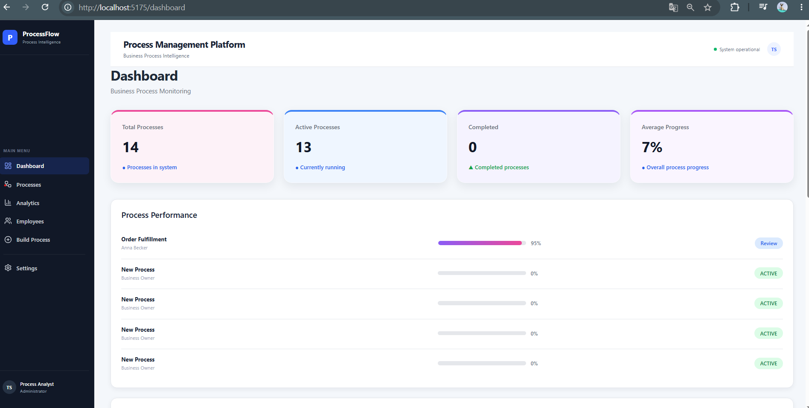
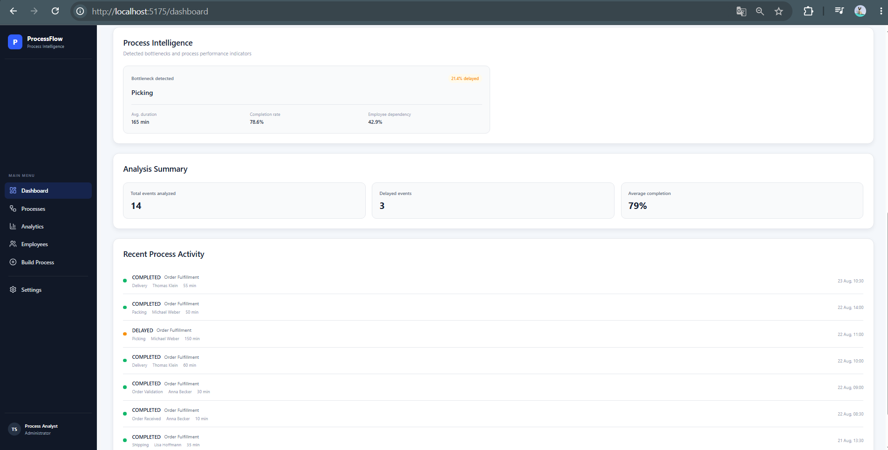
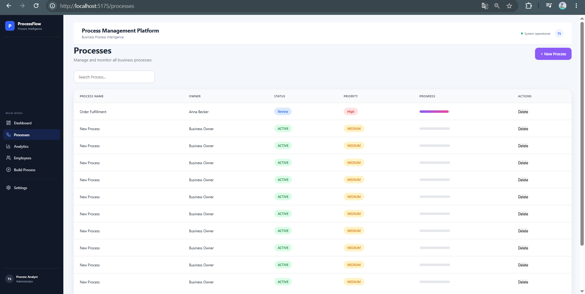
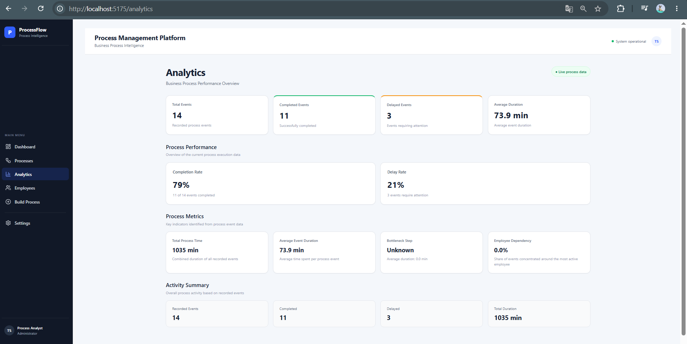

# ProcessFlow — Process Management Platform

A full-stack web application for managing business processes, organising workflows and analysing operational performance.

 **ProcessFlow** connects application development with structured data management. The goal is to make workflows easier to understand, track process execution and identify areas where operations could be improved.

## Demo

## Screenshots

### Dashboard

### Process Intelligence

### Process Management

### Analytics

## Key Features

- Create and manage business processes
- Start workflows from templates or build them from scratch
- Organise process steps, responsibilities and priorities
- Record process events and track execution
- Review completion rates, delays and processing times
- Explore potential bottlenecks and employee dependencies
- Display operational indicators in a dashboard

## Technical Architecture

The application separates the user interface, application logic and data persistence.

React Frontend
      |
      | REST API (JSON / HTTP)
      v
Spring Boot Backend
      |
      | Spring Data JPA / Hibernate
      v
PostgreSQL Database

This structure supports separation of concerns and makes individual parts easier to maintain and extend.

## Technology Stack

Area| Technologies
Frontend| React, JavaScript, HTML, CSS
Backend| Java, Spring Boot
API| REST, JSON, HTTP
Database| PostgreSQL
Data Access| Spring Data JPA, Hibernate
Tools| Visual Studio Code, Eclipse, Git, GitHub

## Project Focus

This project combines several areas of software development:

- Application development: building a user interface and connecting it to backend services.
- Backend logic: structuring application responsibilities and exposing REST endpoints.
- Database design: representing processes, steps, employees, departments and process events.
- Data analysis: deriving operational indicators from recorded process activity.
- Process improvement: using metrics to explore delays, dependencies and potential bottlenecks.

## Current Status

ProcessFlow is a portfolio MVP under active development. The project demonstrates the intended application structure and core workflow-management concepts.

The live preview and backend integration may not yet expose every feature consistently. The screenshots and demo video provide a visual overview of the interface; the source code shows the implementation.

 ## Future Improvements

- Improve reliability of the deployed frontend and backend integration
- Add authentication and role-based access
- Expand validation and error handling
- Improve automated testing
- Add data import and export options
- Extend process analysis and reporting

## About This Project

I developed ProcessFlow as a practical way to strengthen my skills in application development, databases, APIs and business process analysis.

The project reflects my interest in building software that not only stores information, but also helps users understand how work is organised and where it can be improved.

---

*Portfolio project by Tamara Shmyhanovska.*
